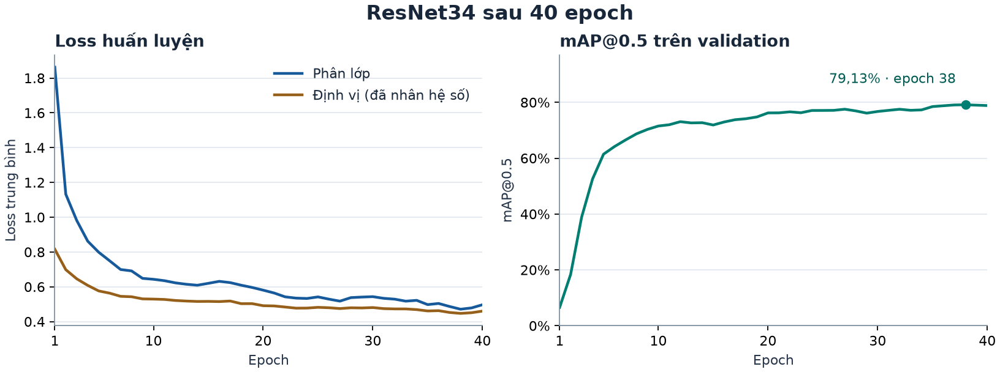

# ObjectDetectionFromScratch — RetinaNet với ResNet34

Dự án phát hiện năm lớp vật thể trong ảnh gồm `person`, `car`, `dog`, `cat` và `chair`. Mô hình dùng ResNet34 pretrained ImageNet để trích xuất đặc trưng. FPN, anchor, đầu dự đoán, loss, giải mã hộp và NMS được triển khai trong dự án.

**Kết quả sau 40 epoch** đạt **70,49% mAP@0.5 trên 1.500 ảnh test**.

## Quick Start — Dự đoán và chấm điểm

Chạy các lệnh từ thư mục gốc dự án trong PowerShell. Đặt ảnh và nhãn vào `public/`. Checkpoint ResNet34 cần nằm tại `resnet34_full/best.pth`.

```powershell
python -m venv .venv
.\.venv\Scripts\python.exe -m pip install -r requirements.txt

.\.venv\Scripts\python.exe -X utf8 predict.py `
  --image_dir public/val/images --annotations splits/val.json `
  --checkpoint resnet34_full/best.pth --conf_thresh 0.25 --nms_thresh 0.4 `
  --output runs/val_predictions.json

.\.venv\Scripts\python.exe -X utf8 public/tools/evaluate_predictions.py `
  --ground_truth splits/val.json --predictions runs/val_predictions.json `
  --output runs/val_score.json
```

Tệp [`val_score.json`](resnet34_full/val_score.json) của lượt chạy đã lưu có các chỉ số sau.

```json
{
  "mAP@0.5": 0.705035,
  "performance_points": 20,
  "micro_precision": 0.743781,
  "micro_recall": 0.739733
}
```

| Tham số `predict.py` | Mặc định | Ý nghĩa |
| --- | --- | --- |
| `--checkpoint` | `models/best.pth` | Đường dẫn trọng số. Lệnh trên dùng `resnet34_full/best.pth`, checkpoint EMA ở epoch 38, khoảng 97 MiB. |
| `--conf_thresh` | `0.3` | Ngưỡng điểm tin cậy để giữ phát hiện. Lượt chấm đã lưu dùng `0.25`. |
| `--nms_thresh` | `0.4` | Ngưỡng IoU để loại hộp trùng trong cùng lớp. |
| `--batch_size` | `8` | Số ảnh mỗi batch suy luận. |
| `--device` | Tự chọn CUDA hoặc CPU | Có thể đặt `cuda:0` hoặc `cpu`. |
| `--annotations` | Đọc cả thư mục ảnh | Khi truyền tệp split, chỉ dự đoán các ảnh có ID trong tệp. |
| `--tta` | Tắt | Suy luận thêm trên ảnh lật ngang rồi gộp dự đoán. |

---

## Demo trên trình duyệt

Từ thư mục dự án, chạy lệnh sau rồi mở [trang demo](http://127.0.0.1:7861) trên máy chạy Python.

```powershell
.\.venv\Scripts\python.exe -X utf8 web_demo.py
```

Trang tự chạy nhận diện trên một ảnh test khi mở. Bạn có thể chọn ảnh test khác, bật **Hiện nhãn thật**, tải ảnh riêng lên hoặc bấm **Dán ảnh** để nhận diện ảnh đã sao chép. **Ctrl+V** cũng dán ảnh trực tiếp. Dùng thanh trượt độ tin cậy, NMS và tùy chọn TTA để thay đổi cấu hình suy luận, rồi bấm **Chạy nhận diện**. Mục **Đánh giá** hiển thị mAP, precision, recall và AP từng lớp trích từ kết quả đã lưu.

Demo dùng `resnet34_full/best.pth` và tự chọn GPU hoặc CPU. Giữ Terminal mở khi trình bày. Nếu cổng đã được dùng, thêm `--port 7862` và mở `http://127.0.0.1:7862`.

### Chạy demo bằng Docker

Mở Docker Desktop hoặc Docker Engine có Docker Compose. Đặt checkpoint tại `resnet34_full/best.pth`, rồi chạy từ thư mục dự án.

```sh
docker compose up --build
```

Mở [trang demo](http://127.0.0.1:7861), sau đó dán hoặc tải ảnh của bạn lên. Docker dùng CPU và chỉ cần checkpoint để nhận diện ảnh. Xem thêm [hướng dẫn Docker](DEMO_WEB.md#4-chạy-demo-bằng-docker).

## Yêu cầu và mã triển khai

| Hạng mục | Tệp | Triển khai |
| --- | --- | --- |
| Đọc dữ liệu, chia tập và tăng cường ảnh | `utils/dataset.py`, `tools/split_dataset.py` | Đọc nhãn theo ID ảnh, biến đổi đồng thời ảnh và hộp. |
| Trích xuất đặc trưng | `models/backbone.py`, `models/tiny_backbone.py` | ResNet hoặc TinyBackbone, trả về C3, C4 và C5. |
| Phát hiện ở nhiều độ phân giải | `models/fpn.py`, `utils/anchors.py`, `models/head.py` | Tạo P3–P7, sinh anchor, dự đoán lớp và độ lệch hộp. |
| Ghép anchor và tính loss | `models/loss.py`, `utils/box_utils.py` | Ghép theo IoU, dùng Focal Loss và loss định vị. |
| Suy luận và xuất JSON | `predict.py`, `models/detector.py`, `utils/nms.py` | Lọc confidence, khử trùng hộp theo lớp và trả tọa độ ảnh gốc. |
| Chấm mAP@0.5 | `utils/metrics.py`, `public/tools/evaluate_predictions.py` | Theo dõi validation khi train và chấm dự đoán sau huấn luyện. |

## 1. Quy trình xử lý dữ liệu

### 1.1. Đọc ảnh và nhãn

`DetectionDataset` nhóm các hộp thật theo `image_id` và ánh xạ tên lớp sang chỉ số. Mỗi bản ghi ảnh có ID, đường dẫn, chiều rộng và chiều cao. Mỗi bản ghi nhãn có `image_id`, `class` và `bbox` theo định dạng `[xmin, ymin, xmax, ymax]` tính bằng pixel.

| Tập | Tệp nhãn | Số ảnh | Số hộp | Thư mục ảnh |
| --- | --- | ---: | ---: | --- |
| Train | `splits/train.json` | 6.000 | 8.498 | `public/train/images` |
| Validation | `splits/val.json` | 1.500 | 2.021 | `public/val/images` |
| Test | `splits/test.json` | 1.500 | 2.144 | `public/train/images` |

`tools/split_dataset.py` giữ nguyên validation và lấy 1.500 ảnh từ train gốc làm test với seed 42. Việc chia dựa trên tổ hợp lớp trong từng ảnh. Ảnh train và test dùng chung thư mục trên đĩa, còn tệp nhãn xác định ảnh của từng tập.

### 1.2. Resize và chuẩn hóa

Ảnh được đọc bằng Pillow dưới dạng RGB, resize về kích thước vuông và chuẩn hóa theo mean và standard deviation của ImageNet. Hộp bao được co giãn theo từng trục và giới hạn trong biên ảnh. Pipeline lưu kích thước ảnh gốc để hoàn nguyên tọa độ sau suy luận.

### 1.3. Xử lý ảnh có nhiều vật thể

DataLoader xếp các tensor ảnh cùng kích thước thành batch `[B, 3, H, W]` và giữ một danh sách nhãn theo ảnh. Mỗi phần tử của danh sách chứa số hộp tương ứng, kể cả trường hợp ảnh có 0 hộp.

### 1.4. Tăng cường dữ liệu

| Kỹ thuật | Xác suất khi huấn luyện | Cách xử lý |
| --- | ---: | --- |
| Color jitter | 80% mỗi ảnh trước khi ghép | Đổi độ sáng, tương phản, bão hòa và sắc độ. |
| Crop ngẫu nhiên | 50% | Giữ các vật thể có tâm nằm trong vùng cắt. |
| Lật ngang / lật dọc | 50% / 15% | Phản chiếu tọa độ hộp cùng ảnh. |
| Random Erasing | 20% | Che một vùng chữ nhật sau chuẩn hóa. |
| Mosaic | 40% | Ghép bốn ảnh vào một ảnh, rồi đổi tọa độ hộp theo từng vùng. |
| MixUp | 15% | Trộn ảnh và gộp nhãn từ ảnh thứ hai. |

### 1.5. Huấn luyện đa kích thước

Với ảnh cơ sở 512 px, `train.py` chọn một kích thước mỗi epoch trong khoảng 384–640 px, bước 32 px. Validation và test suy luận ở 512 × 512 px.

## 2. Kiến trúc mô hình

```text
Ảnh RGB → ResNet34 (C3–C5) → FPN (P3–P7) → Classification head + Box regression head
                                                                  ↓
                                            Decode → Confidence filter → NMS theo lớp
```

### 2.1. Backbone

`models/backbone.py` dùng ResNet34 từ torchvision với trọng số ImageNet. Stem và stage đầu được đóng băng. BatchNorm trong backbone giữ thống kê đã học. C3, C4, C5 có stride 8, 16, 32 và lần lượt có 128, 256, 512 kênh. CLI cũng hỗ trợ ResNet18, ResNet50 và các biến thể TinyBackbone.

### 2.2. Feature Pyramid Network

`models/fpn.py` chiếu C3–C5 về 256 kênh bằng convolution 1 × 1 và GroupNorm. Tín hiệu được upsample và cộng với đặc trưng ở mức có kích thước lớn hơn để tạo P3–P5. Hai convolution stride 2 sinh P6 và P7.

### 2.3. Anchor generator

`utils/anchors.py` sinh **15 anchor tại mỗi vị trí** từ ba hệ số kích thước và năm tỷ lệ rộng/cao `0.33, 0.5, 1, 2, 3`. Ảnh 512 × 512 có tổng cộng **81.840 anchor** trên P3–P7. Anchor được sắp theo tầng, hàng, cột, hệ số kích thước và tỷ lệ để khớp với thứ tự dự đoán.

### 2.4. Detection heads

Hai nhánh trong `models/head.py` chia sẻ trọng số giữa các mức FPN. Mỗi nhánh có bốn khối convolution tách theo chiều sâu, GroupNorm và GELU. Nhánh phân lớp trả tensor `[B, A, 5]`, còn nhánh hồi quy trả `[B, A, 4]`, với `A` là tổng anchor.

### 2.5. RetinaDetector

`models/detector.py` nối backbone, FPN và đầu dự đoán. Mô hình lưu anchor theo kích thước đầu vào và thiết bị để tái sử dụng giữa các batch.

## 3. Hàm mất mát

### 3.1. Ghép anchor với hộp thật

`DetectionLoss._match` tính IoU giữa anchor và các hộp thật. Anchor có IoU tốt nhất từ 0,5 được gán dương, dưới 0,4 được gán nền. Các anchor ở khoảng giữa được bỏ qua. Mỗi hộp thật còn đề cử anchor có IoU cao nhất để bổ sung anchor dương.

### 3.2. Focal Loss cho phân lớp

Mô hình dùng sigmoid theo từng lớp và Focal Loss với `alpha=0.25`, `gamma=2.5`, label smoothing `0.01`. Trọng số lớp được tính từ tần suất trên tập train và giới hạn ở mức 3.

### 3.3. Loss định vị

Lượt ResNet34 dùng **CIoU** trên các hộp đã giải mã từ anchor dương. CIoU xét độ chồng lấp, khoảng cách giữa tâm hộp và chênh lệch tỷ lệ khung hình. CLI cũng hỗ trợ GIoU và Smooth L1. Tổng loss gồm Focal Loss và loss định vị nhân hệ số 2. Hai thành phần được chuẩn hóa theo số anchor dương trong batch, với mẫu số tối thiểu là 1.

### 3.4. Optimizer và learning rate

Huấn luyện dùng AdamW, weight decay `5e-4`, warmup 1.000 bước và lịch cosine có khởi động lại. Learning rate của backbone, FPN và head lần lượt bằng `0.05×`, `0.30×` và `1×` learning rate cơ sở. Gradient norm được giới hạn ở 5.

## Training — Huấn luyện ResNet34

Đặt dữ liệu gốc vào `public/` với `annotations/train.json`, `annotations/val.json`, `train/images/`, `val/images/` và `tools/evaluate_predictions.py`. Kiểm tra dữ liệu bằng `python -X utf8 -m tools.check_environment`. Có thể tạo lại split bằng `python -X utf8 -m tools.split_dataset`.

Lệnh dưới dùng môi trường Python có CUDA. Khi khởi tạo ResNet34 lần đầu, torchvision tải trọng số ImageNet nếu máy chưa có trong cache.

```powershell
.\.venv\Scripts\python.exe -X utf8 -u train.py `
  --train_data splits/train.json --val_data splits/val.json `
  --image_dir public/train/images --val_image_dir public/val/images `
  --checkpoint_dir runs/resnet34_train --device cuda:0 --num_workers 2 `
  --backbone resnet34 --fpn_channels 256 --img_size 512 --batch_size 8 `
  --epochs 40 --lr 1e-4 --warmup_iters 1000 `
  --multi_scale --ms_max_size 640 --reg_loss_type ciou `
  --ema --swa --use_tta --reference_recipe
```

| Tham số | Giá trị trong lượt chạy | Mục đích |
| --- | --- | --- |
| `--epochs`, `--batch_size` | 40, 8 | Tổng số epoch và số ảnh mỗi batch. |
| `--multi_scale`, `--ms_max_size` | Bật, 640 px | Đổi kích thước ảnh train giữa các epoch. |
| `--reg_loss_type` | `ciou` | Loss định vị hộp. |
| `--ema` | Bật | Duy trì bản trung bình lũy thừa của trọng số. |
| `--swa` | Bật từ epoch 31 | Tích lũy trung bình trọng số trong giai đoạn cuối. |
| `--use_tta` | Bật trong validation | Chấm trên ảnh gốc và ảnh lật ngang trong lúc train. |

Ở cấu hình này, mAP của trọng số đang train được dùng để chọn epoch. Khi mAP đạt mức cao mới, trọng số EMA của epoch đó được lưu vào `best.pth`. Sau mỗi epoch, `last.pth` lưu trạng thái model, optimizer và scheduler. Nếu phiên chạy bị ngắt, chạy lại cùng lệnh với `--resume runs/resnet34_train/last.pth`. Có thể dùng `--stop_after_epoch` để dừng sau một epoch đã lưu trong khi vẫn lập lịch cho đủ 40 epoch.

## 4. Suy luận

### 4.1. Forward pass

`predict.py` nạp backbone, FPN và head theo cấu hình trong checkpoint. Ảnh được chuẩn hóa như khi validation và xử lý theo batch.

### 4.2. Giải mã hộp

`utils/box_utils.py` giải mã `dx, dy, dw, dh` thành vị trí tâm, chiều rộng và chiều cao của hộp, rồi trả lại tọa độ góc.

### 4.3. Lọc confidence

Sigmoid đổi logit thành điểm theo từng lớp. Detector giữ các cặp anchor–lớp vượt ngưỡng và giới hạn số ứng viên trước NMS.

### 4.4. NMS theo lớp

`utils/nms.py` ưu tiên hộp có điểm cao nhất và loại các hộp cùng lớp bị chồng lấp quá ngưỡng. Kết quả cuối giữ tối đa 100 hộp mỗi ảnh theo mặc định.

### 4.5. Chuyển tọa độ về ảnh gốc

Detector đổi tỷ lệ theo chiều rộng và chiều cao gốc, rồi cắt tọa độ về trong biên ảnh. `predict.py` loại hộp quá nhỏ trước khi làm tròn tọa độ.

### 4.6. Định dạng JSON

Mỗi ảnh có một mục gồm `image_id` và `boxes`. Ví dụ một dự đoán có dạng sau.

```json
[
  {
    "image_id": "anh_01.jpg",
    "boxes": [
      {"class": "dog", "confidence": 0.913275, "bbox": [42.5, 28.0, 287.0, 346.5]}
    ]
  }
]
```

### 4.7. Test-Time Augmentation và chấm test

TTA chạy trên ảnh gốc và ảnh lật ngang, đổi hộp từ ảnh lật về cùng hệ tọa độ rồi gộp trước NMS. Lượt chấm checkpoint cuối dùng confidence 0,25, NMS 0,4 và TTA tắt.

```powershell
.\.venv\Scripts\python.exe -X utf8 predict.py `
  --image_dir public/train/images --annotations splits/test.json `
  --checkpoint resnet34_full/best.pth --conf_thresh 0.25 --nms_thresh 0.4 `
  --output runs/test_predictions.json

.\.venv\Scripts\python.exe -X utf8 public/tools/evaluate_predictions.py `
  --ground_truth splits/test.json --predictions runs/test_predictions.json `
  --output runs/test_score.json
```

## Results — Kết quả thực nghiệm

### ResNet34 trên validation và test

| Tập | Số ảnh | mAP@0.5 | Precision (micro) | Recall (micro) |
| --- | ---: | ---: | ---: | ---: |
| Validation | 1.500 | 70,50% | 74,38% | 73,97% |
| Test | 1.500 | **70,49%** | **74,36%** | **72,11%** |

mAP@0.5 lấy trung bình AP của năm lớp ở ngưỡng IoU 0,5. Precision và recall micro tính từ tổng số hộp đúng, sai và bỏ sót trên toàn bộ lớp. Hai tập được chấm với checkpoint EMA ở epoch 38.

### Kết quả từng lớp trên test

| Lớp | AP@0.5 | Precision | Recall |
| --- | ---: | ---: | ---: |
| `person` | 70,75% | 82,15% | 72,80% |
| `car` | 69,51% | 68,75% | 73,59% |
| `dog` | 85,35% | 65,59% | 89,27% |
| `cat` | 86,29% | 83,91% | 87,43% |
| `chair` | 40,54% | 52,47% | 47,10% |

### Training curves



Trong [nhật ký huấn luyện](resnet34_full/training_history.json), điểm validation của trọng số đang train với TTA đạt đỉnh **79,13% ở epoch 38**. Kết quả chấm cuối trong bảng dùng trọng số EMA đã lưu với TTA tắt.

| Tệp | Nội dung |
| --- | --- |
| `resnet34_full/best.pth` | Trọng số EMA epoch 38 dùng để suy luận. |
| [`val_score.json`](resnet34_full/val_score.json), [`test_score.json`](resnet34_full/test_score.json) | Điểm số tổng hợp và theo lớp. |
| [`val_predictions.json`](resnet34_full/val_predictions.json), [`test_predictions.json`](resnet34_full/test_predictions.json) | Dự đoán của từng ảnh để chạy lại công cụ chấm. |

## Project Structure

Cây dưới đây liệt kê các tệp chính để huấn luyện ResNet34, chấm điểm và chạy demo.

```text
ObjectDetectionFromScratch/
├── models/
│   ├── backbone.py               # ResNet trích xuất đặc trưng C3–C5
│   ├── tiny_backbone.py          # Backbone CNN nhẹ
│   ├── fpn.py                    # Tạo tháp đặc trưng P3–P7
│   ├── head.py                   # Dự đoán lớp và độ lệch hộp
│   ├── loss.py                   # Ghép anchor, tính loss phân lớp và định vị
│   └── detector.py               # Ghép mô hình, giải mã hộp và suy luận
├── utils/
│   ├── dataset.py                # Đọc ảnh, nhãn và tăng cường dữ liệu
│   ├── anchors.py                # Sinh hộp neo trên các mức FPN
│   ├── box_utils.py              # IoU, mã hóa và giải mã hộp
│   ├── nms.py                    # Khử hộp trùng theo lớp
│   └── metrics.py                # Tính AP và mAP trong quá trình train
├── public/
│   ├── annotations/              # Nhãn train và validation gốc
│   ├── train/images/             # Ảnh train gốc, gồm cả ảnh giữ lại làm test
│   ├── val/images/               # Ảnh validation
│   └── tools/evaluate_predictions.py
├── splits/
│   ├── train.json                # 6.000 ảnh dùng để huấn luyện
│   ├── val.json                  # 1.500 ảnh dùng để chọn epoch
│   └── test.json                 # 1.500 ảnh dùng để đánh giá cuối
├── resnet34_full/
│   ├── best.pth                  # Trọng số EMA epoch 38
│   ├── training_history.json     # Nhật ký 40 epoch
│   ├── training_curves.png       # Biểu đồ loss và mAP validation
│   ├── val_predictions.json      # Hộp dự đoán trên validation
│   ├── val_score.json            # Điểm validation
│   ├── test_predictions.json     # Hộp dự đoán trên test
│   └── test_score.json           # Điểm test và chỉ số từng lớp
├── tools/
│   ├── split_dataset.py          # Tạo lại split từ nhãn gốc
│   ├── check_environment.py      # Kiểm tra dữ liệu, PyTorch và thiết bị
│   └── visualize.py              # Vẽ ảnh và hộp bao để kiểm tra nhãn
├── tests/                        # Kiểm thử dataset, anchor, hộp bao và NMS
├── web/
│   ├── index.html                # Bố cục trang demo
│   ├── styles.css                # Giao diện và cách hiển thị hộp bao
│   └── demo.js                   # Tải ảnh, gọi mô hình, hiển thị kết quả
├── train.py                      # Huấn luyện và lưu checkpoint
├── predict.py                    # Dự đoán theo thư mục, xuất JSON
├── web_demo.py                   # Khởi động website suy luận trên máy
├── Dockerfile                    # Môi trường CPU để chạy web demo
├── compose.yaml                   # Cổng demo và vị trí checkpoint
├── .dockerignore                 # Loại dataset, checkpoint và cache khỏi build
├── DEMO_WEB.md                   # Hướng dẫn mở và trình bày website
└── requirements.txt              # Thư viện cần cài
```

## Tests

```powershell
.\.venv\Scripts\python.exe -X utf8 -m unittest discover -s tests -v
```

Bộ kiểm thử tự động kiểm tra cách sinh anchor, phép toán trên hộp bao, các biến đổi ảnh và NMS. Thư mục `tools/` có các script riêng để kiểm tra backbone, FPN, head, detector, loss và một bước train.

## FAQ

**Chạy dự đoán trên máy CPU thế nào?** Thêm `--device cpu` vào lệnh `predict.py`. Có thể giảm `--batch_size` xuống `1` để kiểm tra một nhóm ảnh nhỏ.

**Vì sao lệnh chấm test đọc ảnh trong `public/train/images`?** `splits/test.json` liệt kê 1.500 ảnh được giữ lại từ thư mục train gốc. `predict.py` lọc đúng các ID trong tệp đó qua `--annotations`.

**File nào dùng để chạy demo hoặc suy luận?** Dùng `resnet34_full/best.pth` với `predict.py`. Khi lấy mã nguồn bằng Git, đặt checkpoint đã tải ở đường dẫn trên.

**Vì sao lớp `chair` có AP thấp nhất?** Trên tập test, lớp này đạt **40,54% AP@0.5**. Mô hình ghép đúng 138 trong 293 hộp thật, tương ứng recall **47,10%**, và có thêm 125 dự đoán `chair` không ghép được với hộp thật ở ngưỡng IoU 0,5. Cả số hộp bị bỏ sót và số dự đoán sai đều kéo AP xuống. [Điểm test](resnet34_full/test_score.json)

Kết quả phân theo kích thước hộp cho thấy mô hình gặp khó khăn với ghế nhỏ. Với 118 hộp ghế chiếm dưới 5% diện tích ảnh, mô hình chỉ ghép đúng 37 hộp (**31,36%**). Với 175 hộp còn lại, mô hình ghép đúng 101 hộp (**57,71%**). Cùng một độ lệch vài pixel có thể làm IoU của hộp nhỏ giảm nhiều hơn. Trong tập train, `chair` có 1.320 hộp, đứng thứ hai sau `person`. [Nhãn test](splits/test.json) · [Dự đoán test](resnet34_full/test_predictions.json)
